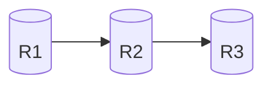
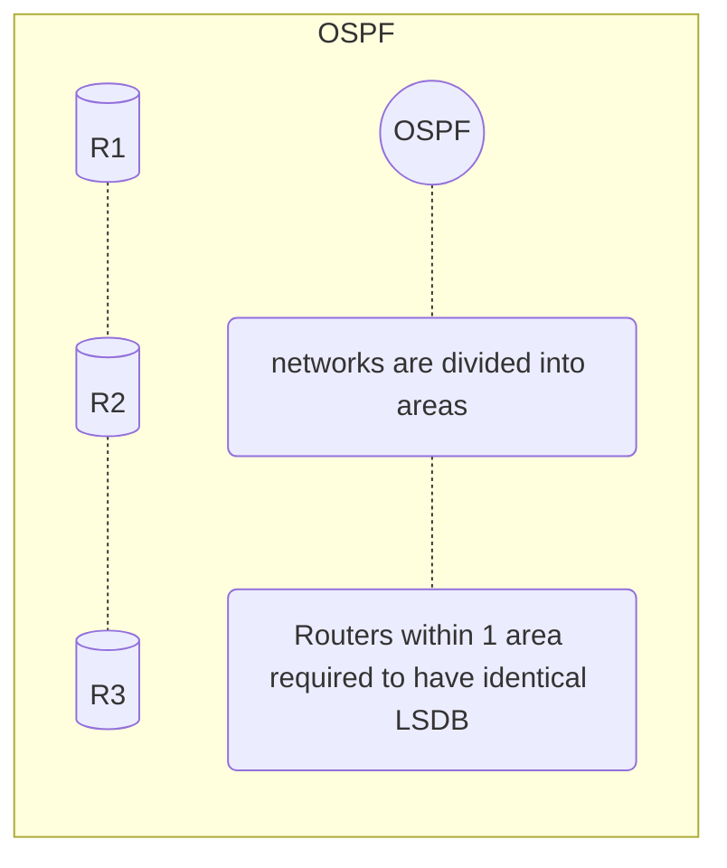

## OSPF Configuration
**Problem**: All the devices need a static route. <br>
R1 Doesn't know how to reach R3 unless you add a static route in its config.  <br>
OSPF enables all the routers to learn the route to each other.






```cisco
RA# show ip ospf neighbor
Router(config)# router ospf process-id
Router(config-router)# router-id rid
Router(config-router)# network network-address wildcard-mask area area-id 
```
## Numbered Standard IPv4 ACLs

```cisco
R2(config)# access-list 1 deny 192.168.11.0 0.0.0.255
```
```cisco
syntax: access-list <number> <source you want to denied> <wild mask>
```
Note: it won’t work unless applied to an outgoing source. <br>
Apply it your outgoing source:
```cisco
R1(config)# ip access-list standard File_Server_Restriction <name>
R1(config-std-nacl)# permit host 192.168.20.4
R1(config-std-nacl)# deny any
```
## Named Extended IPv4 ACL
```cisco
R1(config)# access-list 100 permit icmp 172.22.34.64 0.0.0.31 host 172.22.34.62
```
```cisco
Syntax: access-list <number> <deny/permit> <source address> <network wild card> <destination> <port number>
```
Note: All other traffic is denied by default unless specified otherwise.

## Configure Static NAT
```cisco
R1(config)# ip nat inside source static 172.16.16.1 64.100.50.1
```
```cisco
Syntax: ip nat inside source static <machine’s internal ip> <machine’s external ip>
```
Then Configure the interface
```cisco
R1(config)# interface g0/0
R1(config-if)# ip nat inside
```
Configure Dynamic NAT <br>
1. Define the pool of public addresses:
```cisco
R1(config)# ip nat pool PUBLIC-POOL 209.165.200.225 209.165.200.230 netmask 255.255.255.248
```
2. Create an ACL that identifies which inside addresses are allowed to be translated:
```cisco
R1(config)# access-list 1 permit 192.168.10.0 0.0.0.255
```
3. Bind the ACL to the pool:
```cisco
R1(config)# ip nat inside source list 1 pool PUBLIC-POOL
```
4. Mark the inside and outside interfaces:
```cisco
R1(config)# interface g0/0 
R1(config-if)# ip nat inside 
R1(config-if)# exit 
R1(config)# interface s0/1/0 
R1(config-if)# ip nat outside
```
## Configure SSH

```cisco
S1(config)# ip domain-name netacad.pka 
S1(config)# crypto key generate rsa
S1(config)# username administrator secret cisco
S1(config)# line vty 0 15
S1(config-line)# transport input ssh
S1(config-line)# login local
```
## Configuring VLANS
```cisco
S1#(config)# vlan 10
S1#(config-vlan)# name Faculty/Staff
S2(config)# interface f0/11
S2(config-if)# switchport mode access
S2(config-if)# switchport access vlan 10
```
| Switchport mode access | Purpose |
--- | ---
Access | The port belongs to exactly one VLAN and sends and receives untagged frames. This is for end devices like PCs, printers, and cameras, which don't know anything about VLANs |
Trunk | The port carries traffic for multiple VLANs at once, using 802.1Q tags to say which VLAN each frame belongs to. This is for switch-to-switch links, switch-to-router (router-on-a-stick), and links to hypervisors or APs that handle multiple VLANs. |
dynamic desirable | actively tries to negotiate a trunk. It becomes a trunk if the other side is trunk, desirable, or auto. |
dynamic auto | passively accepts a trunk only if the other side initiates. Two auto ports will end up as access. | 

## Configure Trunk
```cisco
S1(config)# interface range g0/1 – 2
S1(config-if)# switchport mode trunk
S1(config-if)# switchport trunk encapsulation dot1q
S1(config-if)# switchport trunk allowed vlan 10,20,30,40
```
## Router-on-a-Stick
```cisco
R1(config)# int g0/0.10
R1(config-subif)# encapsulation dot1Q 10
R1(config-subif)# ip address 172.17.10.1 255.255.255.0
```
**Explanalation**
- int g0/0.10 creates a subinterface (a virtual interface) on physical port G0/0. The .10 is just a label. Matching it to the VLAN number is a convention that makes the config easier to read.
- encapsulation dot1Q 10 tells the subinterface to send and receive frames tagged with 802.1Q VLAN 10. This line is what ties the subinterface to the VLAN. Without it, the subinterface doesn't know which tagged frames belong to it, and you can't assign an IP address.
- ip address 172.17.10.1 255.255.255.0 gives it an IP in VLAN 10's subnet. Hosts in VLAN 10 use this as their default gateway.
## How to make a Port Routable on a L3 Switch?
```cisco
SW1(config)# ip routing
SW1(config)# interface gigabitethernet 1/0/1
SW1(config-if)# no switchport
SW1(config-if)# ip address 10.1.1.1 255.255.255.252
SW1(config-if)# no shutdown
Enter the ip routing command to enable routing in global configuration mode.
MLS(config)# ip routing

```
## Configure Router as a DHCP Server
```cisco
R2(config)# ip dhcp excluded-address 192.168.10.1 192.168.10.10
a.	Create a DHCP pool named R1-LAN (case-sensitive).
R2(config)# ip dhcp pool R1-LAN
b.	Configure the DHCP pool to include the network address, the default gateway, and the IP address of the DNS server.
R2(dhcp-config)# network 192.168.10.0 255.255.255.0
R2(dhcp-config)# default-router 192.168.10.1
R2(dhcp-config)# dns-server 192.168.20.254
```
## Port Security
```cisco
S1(config)# interface range f0/1 – 2
S1(config-if-range)# switchport port-security
```
> The above command will enable port security on Fast Ethernet ports 0/1 and 0/2.
```c
S1(config-if-range)# switchport port-security maximum 1
```
> The Above ^ command -	Set the maximum so that only one device can access the Fast Ethernet ports 0/1 and 0/2.
