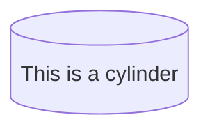
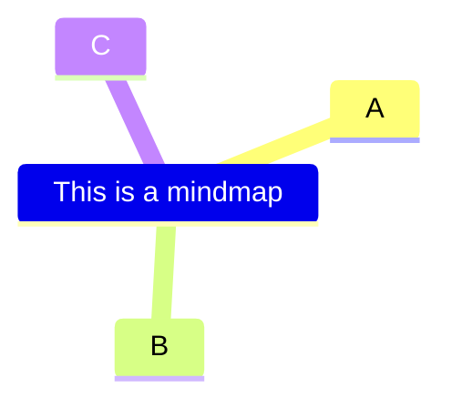
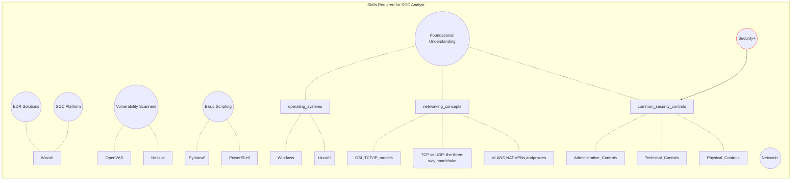

# Mermaid (not the swimming one)
Whenever I am working on homelabs, papers and projects during my cyber security education there often comes the need to draw diagrams. <br>
As it is often said:
>"A picture is worth a thousand words." <br>

Hence, making a diagram turns your project or any data workflow way easier to understand.

I mean who doesn't like pictures? I do! 🙋‍♂️ <br>
So in my journey to find the perfect diagram tool. I came across various options.
- Use the shapes tools in Microsoft Word.
- Use draw.io
- Use Lucidchart

**What do all of the above have in common?** <br>
I have to grab a mouse. <br>
Pick the shape. <br>
Drag it over. <br>
Make the write alignment and shape. <br>
Then hope it turns out as perfect as I imagined it in my head🧠.

Didn't happen very often. <br>
Then I crossed paths with:
# Mermaid!
## Make diagrams by just writing some text. 
Want to see something cool?
```code
graph LR
A[(This is a cylinder)]
```

Lets see more of what it can do:
```code
mindmap
 This is a mindmap
    A
    B
    C
```

I have used it to design myself a graph of some common requirements in a SOC Analyst job posting:

I happy I found this tool and feel like it will be a part of my workflow for years to come now. 😊