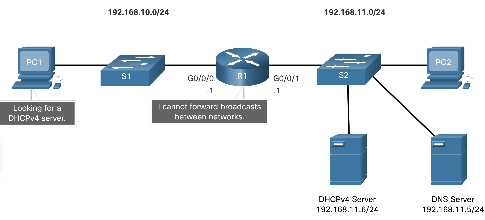

# Cisco DHCP Configuration
Step 1. List down the addresses you don't want to be in the pool.
```
R1(config)# ip dhcp excluded-address 192.168.10.1 192.168.10.9
```
Step 2. Define a DHCPv4 Pool name.

```
syntax
    Router(config)# ip dhcp pool pool-name  
```

```
Example
    R1(config)# ip dhcp pool LAN-POOL-1
```
Step 3. Configure the DHCPv4 Pool
- Define the address pool.

```
syntax
network network-number  [mask | /prefix-length]
```

```
Example
R1(dhcp-config)# network 192.168.10.0 255.255.255.0
```

- Define the default router or gateway.

```
syntax
default router router
```

```
Example
R1(dhcp-config)# default-router 192.168.10.1
```

- Define a DNS server.

```
syntax
dns-server address
```

```
Example
R1(dhcp-config)# dns-server 192.168.11.5
```

- Define the domain name.

```
syntax
domain-name domain
```

```
Example
R1(dhcp-config)# domain-name example.com
```

- Define the duration of the DHCP lease.

```
syntax
lease {days [hours [minutes]] | infinite}
```


- Define the NetBIOS WINS server.

```
syntax
netbios-name-server address
```

## Full Example Configuration
```
R1(config)# ip dhcp excluded-address 192.168.10.1 192.168.10.9
R1(config)# ip dhcp excluded-address 192.168.10.254
R1(config)# ip dhcp pool LAN-POOL-1
R1(dhcp-config)# network 192.168.10.0 255.255.255.0
R1(dhcp-config)# default-router 192.168.10.1
R1(dhcp-config)# dns-server 192.168.11.5
R1(dhcp-config)# domain-name example.com
R1(dhcp-config)# end
```
# Cisco DHCP Relay
Since clients are located on a different subnet from servers, often they are not directly connected. 


<br>
In the picture above you can see the client is not connected directly to the DHCP server. The solution to this problem is **DHCP Relay**. We configure the router as the relay. As we configure R1 with the `ip helper-address` address interface configuration command. This will cause R1 to relay DHCPv4 broadcasts to the DHCPv4 server. 

```
R1(config)# interface g0/0/0
R1(config-if)# ip helper-address 192.168.11.6
R1(config-if)# end
R1#
```

# Cisco Router as a DHCP Client
Sometimes your ISP is your main DHCP provider and in that case your router must become a DHCP client. 

<u>Configuration example:</u>
```
R1(config)# interface G0/0/1
R1(config-if)# ip address dhcp
R1(config-if)# no shutdown
```
