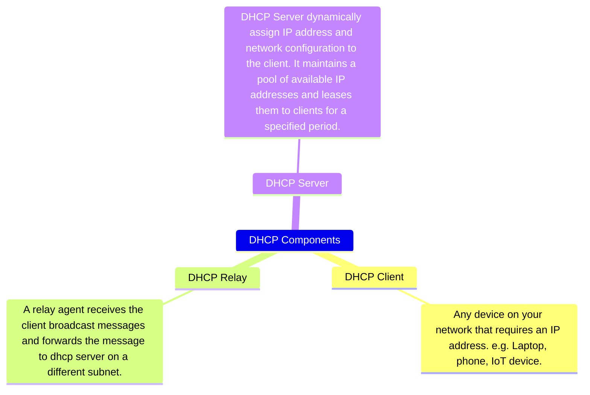
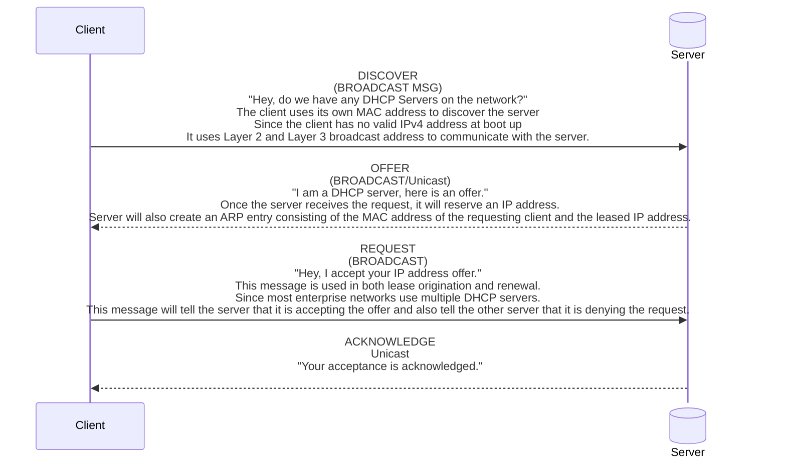

# DHCP
Dynamic Host Configuration Protocol is based on the [Bootstrap Protocol.](https://www.ibm.com/docs/en/ssw_ibm_i_75/pdf/rzal4pdf.pdf)

**Boostrap Protocol** provides the framework to pass configuration information to a client on a TCP/IP network.

DHCP is:
- based on client/server model.
- allocates reusable network addresses and configuration options to clients on the network.
- uses UDP port 67 & 68.
-  The **client** always sends the message with **“Source Port=68”**. (port 68 to port 67)
- The **server** always sends the message with **“Destination Port=67”**. (port 67 to port 68)

DHCP is made up of 2 parts:
1. A protocol to deliver host specific configuration (i.e. IP address, DNS, default gateway) parameters from a DHCP server to a host.
2. A **mechnasim** to allocate network addresses to hosts. 

**<u>3 Mechanisms</u>** of DHCP to allocate IP Address:
1. <u>Automatic Allocation</u>: DHCP assigns a permanent IP address to a client.
2. <u>Dynamic Allocation:</u> IP address is assigned for only a limited period. AKA Lease   DHCP also supports something knows as **ODAP** (On Demand Address Pools). Which basically can increase the pool of available IP adresses based off the current address utlilization level.
3. <u>Manual allocation:</u> The network admin assigns an IP address to a device based off its MAC address. That way that machine will have the same IP address every single time.   
I explored this in my lab for pfSense and DHCP Server in Active Directory domain controller.

> This lease mechanism ensures that clients that are removes or are powered off do not keep addresses that they no longer need.
{: .prompt-info }

## DHCP Primary Components

## DHCP DORA Process

## Why must DHCP be implemented?
1. Saves maual configuration time ⏱️.  You don't have to go to every device in your network and assign it a IP address within your Network's IP address range.
2. Financial reason 💰:  
Static IP addresses are considerably more expensive to purchase than are automatically allocated IP
addresses.
3. Central Management from your server 🖥️:  
You only have to update the parameters on your central server if the networking is to be changed. 

## 🛡️ DHCP Security
1. Since a DHCP server can only provide a limited number of IP Address so, the means an attacker may be able to launch a denial-of-service (DoS) attack by requesting so many IP addresses, rendering essential devices unable to connect.
2. DHCP server can be spoofed: a false DHCP server can be setup on the network providing fraudulent IP addresses.

## Best Practices According to [Fortinet](https://www.fortinet.com/resources/cyberglossary/dynamic-host-configuration-protocol-dhcp)
1. Try not to put DHCP services on the Domain Controller.  
If your DC only has handle the core functions that it won't be overwhelmed with additional work of providing IP addresses via DHCP.   That way the attacker doesn't have the unwanted access to your Domain Controller if it is also serving as the DHCP server.
2. Use DHCP Failover.  
The DHCP backup server.

Sources:
1. <https://www.cisco.com/c/en/us/td/docs/routers/ncs4200/configuration/guide/IP/17-1-1/b-dhcp-17-1-1-ncs4200/b-dhcp-17-1-1-ncs4200_chapter_00.pdf>
2. <https://www.fortinet.com/resources/cyberglossary/dynamic-host-configuration-protocol-dhcp>
3. <https://medium.com/@jenito/lets-understand-dhcp-6ed2d9f58ee9>
