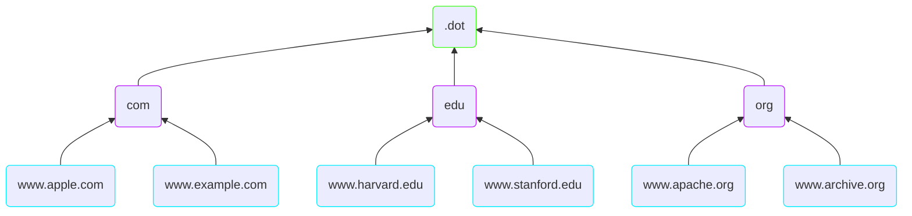
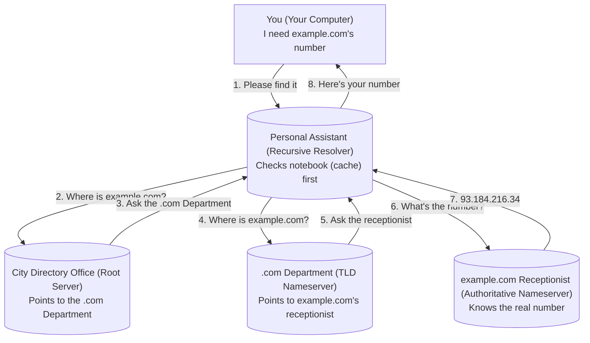
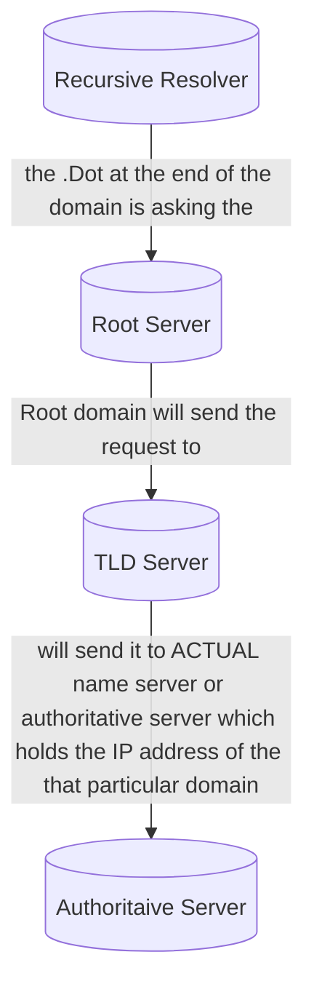

## DNS
Domain Name System.  
Basic understanding that is taught in every networking class is this that is resolves your URL such as www.google.com to an IP address -> 8.8.8.8.

DNS was designed as tree structure. Each domain is a leaf/node in the tree.  The top-most node of the tree is the DNS root
domain (.), under which there are subdomains, such as .com, .edu, .gov, and .mil 

### FQDN
Fully Qualified Domain name aka **absolute domain name** specifies its exact location in the tree hierarchy of the Domain Name System (DNS). It specifies all domain levels, including the top-level domain and the root zone. 

## How does DNS work?
Main Players of the game

|John's computer | Wants to visit www.example.com. |
| :--- | :--- |
|Local DNS server| The computer's first point of contact. Usually provided by your ISP or configured by your organization. |
Root nameserver | Knows where to find the servers responsible for top-level domains like .com, .org, and .net |
|com nameserver | Knows which nameservers manage domains ending in .com. |
example.com nameserver | Knows where to find resources within example.com. |

## Recurvise DNS Resolution

>A small note for your own understanding: "iterative" vs. "recursive" is a common point of confusion. The client-to-resolver leg is recursive (the client asks the resolver to do all the work), while the resolver-to-servers legs are iterative (each server just returns the best answer or referral it has)
{: .prompt-info }

One more diagram to explain it:

> It's a little-known fact, but fully-qualified (unambiguous) DNS domain names have a dot at the end. People running DNS servers usually know this (if you miss the trailing dots out, your DNS configuration is unlikely to work) but the general public usually doesn't.
{: .prompt-info }

## Records
Senior level understanding.
|Name| Type | Value | TTL | Explanation |
|---|---|---|---| --- |
www.example.com | A | 203.0.113.6 (IPv4) | 3600 (1hr)| This means that the URL is the exact mapping of the IP address. It will always point to that exact address. |
|www.example.com | AAAA| 2001:db8::1 (IPv6) | 3600 | Same as above or the "A" record but for an IPv6 address. |
www.example.com blog.example.com api.example.com | CNAME | lb1.aws.com lb2.aws.com lb2 aws.com | 300 | Nothing but a forwarding address, you are forwarding requests from one domain to another.  |
|example.com | NS | ns1.aws.com (this is the server in charge of the aws.co domain) | 172800 | An NS (Name Server) record is a DNS entry that says: "for this domain, these are the servers in charge of its records." |
| example.com | SOA | ns1.dns.com   admin@example.com   Serial #2023120   Refresh 1 hour | | SOA(Start Of Authority) record is the cover page of the DNS zone. It says this is official source of the zone, and here are the rules of the dat should be managed. |
|example.com | TXT | "v=spf1" | 3600 | A TXT record is a DNS entry that holds free-form text attached to a domain. DNS originally had no way to store arbitrary notes, so TXT was created as a general-purpose slot for

## Sources
1. <https://www.youtube.com/watch?v=ZPz4cF5zY84>
2. <https://www.cloudflare.com/learning/dns/dns-records/dns-cname-record/>
3. <https://www.cisco.com/c/en/us/td/docs/net_mgmt/prime/network_registrar/10-1/dns/guide/DNS_Guide/DNS_Guide_chapter_00.pdf>
4. <https://www.dns-sd.org/trailingdotsindomainnames.html>
